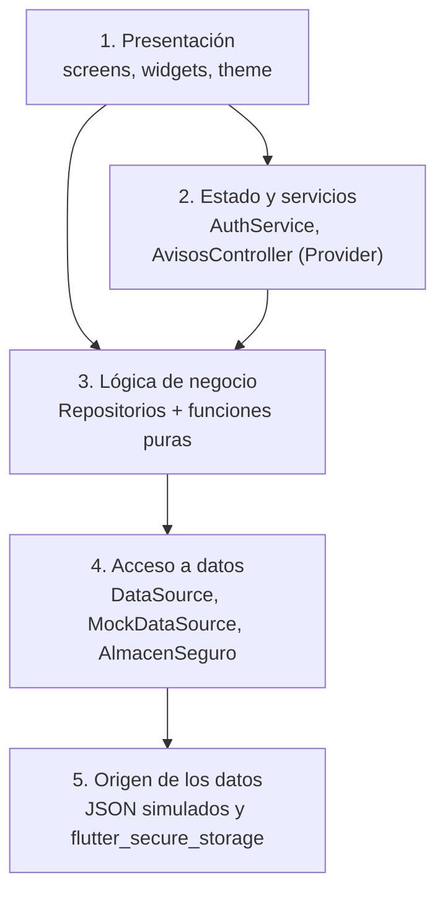
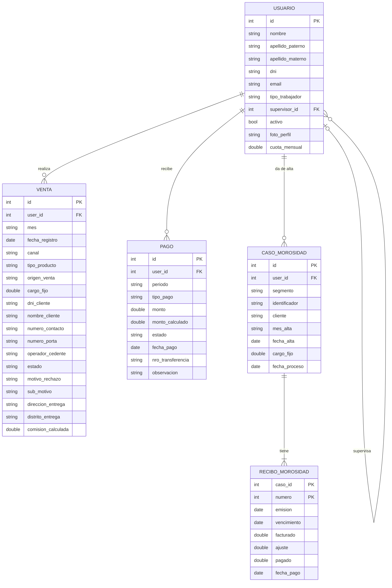
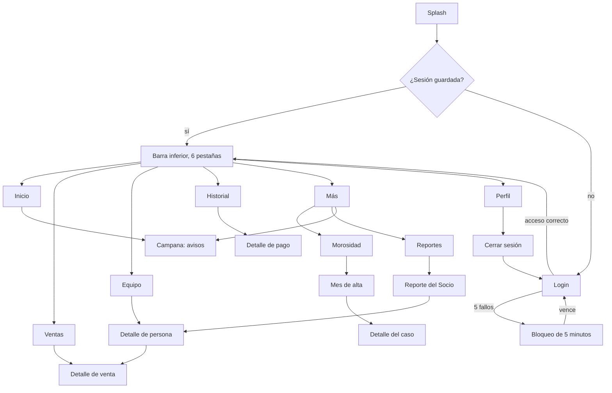

# NABAME Móvil

Aplicación móvil de gestión y control para el Administrador de Corporación NABAME, empresa dedicada a la venta de servicios Movistar (Móvil Postpago, Hogar Fija y Movistar Total). Está desarrollada en Flutter y responde a una pregunta concreta: **¿cómo va la operación?**

Proyecto del curso Taller de Software II, desarrollado con metodología Programación Extrema (XP) en 8 iteraciones.

| | |
|---|---|
| Proyecto | `nabamemovil` |
| Plataforma | Android (probada en un teléfono físico con Android 15) |
| Framework | Flutter, Dart `^3.13.1` |
| Usuario | Administrador (rol único) |
| Datos | Simulados, detrás de una capa de acceso intercambiable |
| Docente | Ing. Rafael Vilca Barbaran |
| Integrantes | Terán Garate Dante, Pezo Isuiza Diego Gabriel, Rengifo Teagua Axel André |

---

## Contenido

1. [Qué resuelve](#1-qué-resuelve)
2. [Funcionalidades](#2-funcionalidades)
3. [Alcance del producto](#3-alcance-del-producto)
4. [Tecnologías](#4-tecnologías)
5. [Puesta en marcha](#5-puesta-en-marcha)
6. [Estructura del proyecto](#6-estructura-del-proyecto)
7. [Arquitectura](#7-arquitectura)
8. [Modelo de datos](#8-modelo-de-datos)
9. [Reglas de negocio](#9-reglas-de-negocio)
10. [Seguridad](#10-seguridad)
11. [Datos de demostración](#11-datos-de-demostración)
12. [Navegación y pantallas](#12-navegación-y-pantallas)
13. [Diseño e identidad visual](#13-diseño-e-identidad-visual)
14. [Pruebas y calidad](#14-pruebas-y-calidad)
15. [Desarrollo por iteraciones](#15-desarrollo-por-iteraciones)
16. [Decisiones técnicas](#16-decisiones-técnicas)
17. [Convenciones de código](#17-convenciones-de-código)
18. [Problemas resueltos durante el desarrollo](#18-problemas-resueltos-durante-el-desarrollo)

---

## 1. Qué resuelve

La fuerza de ventas de NABAME se organiza en una cadena jerárquica: el **Socio Comercial** (externo a NABAME, que reparte entre su equipo la comisión que le corresponde), los **Supervisores** a su cargo y los **Vendedores**, que pueden ser Full-Time, Part-Time o Freelance. Alrededor de esa cadena existen otros cargos: Visor, Back Office y Administrador.

La operación depende de reglas que no son triviales. Una venta recorre hasta 13 estados y solo las entregadas e instaladas generan comisión. Los clientes con recibos pendientes pasan de «en gestión» a «penalizados» según una regla de recibos y una fecha de cierre. Los pagos al personal (sueldo, comisión y bono) se conciliarán por periodo.

NABAME Móvil reúne todo eso en un solo lugar y permite al Administrador:

- ver cuánto se vendió y cuánta comisión se generó en el mes, frente al mes anterior;
- medir el desempeño por vendedor, por supervisor y por Socio Comercial frente a su cuota;
- identificar a tiempo los casos de morosidad que están por cerrar su periodo de penalización;
- saber qué pagos se realizaron y cuáles siguen pendientes;
- recibir avisos de lo urgente sin revisar módulo por módulo.

---

## 2. Funcionalidades

La aplicación se organiza en una barra inferior de seis pestañas: **Inicio, Ventas, Equipo, Historial, Más y Perfil**.

### Acceso

- Splash con logo animado que decide si hay una sesión guardada.
- Login con correo y contraseña, casilla «Recordarme», contraseña oculta por defecto y botón que se rellena como agua al validar.
- Sesión persistente: si hay sesión guardada, la aplicación entra directo al panel.
- Bloqueo tras 5 intentos fallidos durante 5 minutos, con cuenta regresiva en pantalla.
- Cierre de sesión con confirmación.

### Inicio (Dashboard)

- Comisión del mes con conteo animado y variación frente al mes anterior.
- Gráfico de línea con selector «Este mes» e «Histórico».
- Cinco accesos rápidos.
- Ranking de vendedores.
- Campana de avisos con contador.

### Ventas

- Listado agrupado por mes, con buscador (cliente, DNI, teléfono o vendedor, sin distinguir tildes), orden y filtros por estado y mes.
- Detalle de la venta con comisión, DNI enmascarado por defecto (con ojo para verlo) y copiado de datos con pulsación larga.

### Equipo

- Jerarquía Socio Comercial, Supervisores y Vendedores, con sangría y línea lateral.
- Por persona y sobre su equipo completo: ventas, comisión generada, personas a cargo y barra de rendimiento sobre la cuota.
- Personas inactivas aparte, pero incluidas en los totales; grupo «Sin supervisor asignado».
- Detalle de persona.

### Morosidad

- Selector Móvil y Fija.
- Lista por mes de alta, con deuda por gestionar, casos por estado y barra de proporciones.
- Aviso en rojo cuando el cierre de penalización está a 15 días o menos.
- Detalle del caso con sus tres recibos.

### Reportes

- Comisión generada por Socio Comercial en el mes elegido.
- Porcentaje sobre el total y desglose por Supervisor y Vendedor.
- Botón «Copiar resumen» con un texto listo para compartir.

### Historial de pagos

- Pagos agrupados por periodo, con cifras de Pagado y Pendiente según los filtros activos.
- Filtros por estado y tipo (sueldo, comisión, bono) y búsqueda por persona, tipo o número de transferencia.
- Detalle del pago con monto calculado y diferencia.

### Notificaciones

Avisos calculados a partir de los datos y ordenados por urgencia:

| Aviso | Cuándo aparece | Lleva a |
|---|---|---|
| Cierre de penalización | Un mes cierra en 15 días o menos y tiene casos en gestión | Morosidad |
| Pagos pendientes | Hay pagos pendientes; un aviso por periodo con la suma de sus montos | Historial |
| Ventas no entregadas | Hay ventas no entregadas en el mes más reciente | Ventas |

Se abren desde la campana en una ventana inferior, con «Marcar todas» y marcado individual de leídos.

### Más y Perfil

- **Más:** accesos a Morosidad, Reportes y Notificaciones.
- **Perfil:** datos de la cuenta del Administrador y cierre de sesión. El avatar con la inicial abre un menú con «Ver perfil».

---

## 3. Alcance del producto

NABAME Móvil es una aplicación de **consulta y control**, pensada para un único rol.

| Incluye | No incluye por diseño |
|---|---|
| Consulta de ventas, comisiones, pagos, morosidad y estructura del equipo | Registrar, editar, asignar o aprobar ventas |
| Medición de desempeño por vendedor, supervisor y Socio Comercial | Carga de archivos o registro manual de pagos |
| Avisos derivados de los datos | Roles de acceso adicionales (Vendedor, Supervisor, Visor) |
| Acceso seguro del Administrador | Módulo de novedades |

El enfoque de gestión y no operativo mantiene la aplicación simple y segura, y evita exponer información de los vendedores que trabajan en campo.

---

## 4. Tecnologías

| Componente | Detalle |
|---|---|
| Framework y lenguaje | Flutter (canal estable) y Dart `^3.13.1` |
| Estado e inyección de dependencias | `provider` |
| Almacenamiento seguro | `flutter_secure_storage` (sesión, correo recordado y estado del bloqueo) |
| Gráficos | `fl_chart` |
| Fechas y moneda | `intl`, con formato peruano (`S/ 135.00`) |
| Tipografías | `google_fonts` (Inter y Sora) |
| Persistencia local | `sqflite` y `path` |
| Herramientas | Android Studio, VS Code con extensiones de Flutter y Dart, Git |
| Entorno de desarrollo | Windows 10 Home 22H2 |

---

## 5. Puesta en marcha

### Requisitos

- Flutter instalado y verificado con `flutter doctor`.
- Android Studio con las Command-line Tools del SDK de Android y sus licencias aceptadas.
- Un teléfono Android con depuración USB activada y modo USB en «Transferencia de archivos», o un emulador.

### Instalación y ejecución

```bash
cd nabamemovil
flutter pub get
flutter devices          # confirma que el teléfono aparece
flutter run
```

Los archivos de datos (`lib/mock_data/`) y el logo (`assets/images/`) están declarados en `pubspec.yaml`. Al agregar o cambiar un recurso se debe hacer un reinicio completo de la aplicación, no solo un hot reload.

### Credenciales de demostración

| Campo | Valor |
|---|---|
| Correo | `admin@nabame.pe` |
| Contraseña | `Nabame2026` |

Todos los datos de la aplicación son simulados.

### Análisis y pruebas

```bash
flutter analyze          # análisis estático
flutter test             # pruebas unitarias
```

---

## 6. Estructura del proyecto

```
nabamemovil/
  assets/images/            logo de NABAME
  lib/
    data/
      auth/                 auth_service.dart, limite_intentos, almacen_seguro
      datasource/           data_source.dart, mock_data_source.dart
      repositories/         venta_, pago_, morosidad_ y notificaciones_repository
    mock_data/              usuarios.json, ventas.json, pagos.json, morosidad.json
    models/                 usuario, usuario_jerarquia, venta, pago, tipo_trabajador,
                            tipo_producto, venta_estado, perfil_administrador,
                            caso_morosidad (incluye ReciboMorosidad)
    screens/                splash, login, shell, dashboard, ventas, equipo,
                            morosidad, reportes, historial, mas, perfil
    theme/                  app_theme.dart (AppColors, AppTypography)
    utils/                  formato.dart
    widgets/                componentes compartidos
    main.dart               registro de dependencias con MultiProvider
  test/                     pruebas unitarias y soporte/almacen_en_memoria.dart
  pubspec.yaml
```

---

## 7. Arquitectura

La aplicación separa cinco responsabilidades. Las pantallas no conocen el origen de los datos: dependen de repositorios, y estos dependen de la interfaz `DataSource`. Los cálculos de negocio viven en funciones puras que se prueban sin pantallas ni datos externos.



### Componentes principales

| Capa | Componentes |
|---|---|
| Presentación | Splash, Login, AppShell, Dashboard, Ventas, Equipo, Morosidad, Reportes, Historial, Más, Perfil, Avisos, tema y componentes compartidos |
| Estado y servicios | `AuthService` (sesión e intentos de acceso), `AvisosController` (avisos leídos) |
| Lógica de negocio | `VentaRepository`, `PagoRepository`, `MorosidadRepository`, `NotificacionesRepository` y las funciones puras `ArbolEquipo`, `ReporteComision`, `ResumenMorosidad`, `HistorialPagos`, `Avisos` y `LimiteIntentos` |
| Acceso a datos | `DataSource` (interfaz), `MockDataSource` (implementación) y `AlmacenSeguro` (interfaz con implementación real y otra en memoria para pruebas) |
| Origen | `lib/mock_data/*.json` y `flutter_secure_storage` |

### Patrones aplicados

- **Inversión de dependencias:** `DataSource` es una interfaz. `MockDataSource` la implementa leyendo los JSON empaquetados, con 400 ms de latencia simulada y caché. Conectar un servidor real solo requiere una nueva implementación (por ejemplo, `ApiDataSource`), sin modificar pantallas ni cálculos.
- **Un repositorio por responsabilidad,** registrados con `Provider` en `main.dart`.
- **Funciones puras para la lógica:** reciben datos y devuelven resultados, sin pantallas ni dependencias externas.
- **Datos derivados que se calculan y no se guardan:** estado, deuda, penalidad y cierre de morosidad, comisión por nodo y avisos tienen una sola fuente de verdad.
- **Modelos inmutables:** campos `final` y enumeraciones que fallan de forma explícita ante un valor desconocido.
- **Abstracción del almacenamiento seguro:** `AlmacenSeguro` permite probar `AuthService` con un almacén en memoria.
- **Fecha de corte tomada de los datos:** los días de cierre de morosidad no cambian solos con la fecha del dispositivo.

---

## 8. Modelo de datos

### Diagrama entidad-relación



Los nombres de los atributos corresponden a las claves de los archivos JSON. `supervisor_id` es opcional: un usuario puede no tener superior. Los recibos de un caso se guardan anidados dentro de él y su clave es la pareja (`caso_id`, `numero`). Los pagos de comisión no se calculan a partir de las ventas, por lo que no existe relación directa entre `VENTA` y `PAGO`.

### Clases y enumeraciones

| Clase | Descripción | Miembros derivados |
|---|---|---|
| `Usuario` | Persona de la cadena de ventas | `nombreCompleto`, `nombreCorto`, `iniciales` y, mediante la extensión `JerarquiaDeUsuario`, `esSocioComercial`, `esSupervisor`, `esVendedor`, `puedeTenerEquipo`, `perteneceALaCadenaDeVentas` |
| `Venta` | Venta de un servicio | `puedeCambiarEstado` |
| `Pago` | Sueldo, comisión o bono | |
| `CasoMorosidad` | Cliente con recibos pendientes | `titulo`, `deudaTotal`, `esPenalizado`, `estado`, `penalidad`, `cierrePenalizacion` |
| `ReciboMorosidad` | Uno de los tres recibos de un caso | `pendiente`, `tieneDeuda` |

| Enumeración | Valores |
|---|---|
| `TipoTrabajador` | admin, supervisor, fullTime, partTime, freelance, backOffice, visor, socioComercial (son vendedores fullTime, partTime y freelance) |
| `TipoProducto` | movil, fija, movistarTotal |
| `VentaEstado` | registrado, agendado, cancelado, asignado, preparado, despachado, entregado, noEntregado, rechazado, asignadoTec, instalado, observado, sinFftt |
| `TipoPago` | comision, bono, sueldo |
| `EstadoPago` | pendiente, pagado |
| `SegmentoMorosidad` | movil, fija |
| `EstadoMorosidad` | alDia, enGestion, penalizado |

`VentaEstado` expone `esFinal` (entregado, instalado y cancelado) y `generaComision` (entregado e instalado).

---

## 9. Reglas de negocio

### Morosidad

| Concepto | Regla |
|---|---|
| Deuda de un recibo | Facturado menos ajuste menos pagado, sin bajar de cero |
| Penalizado | Existe el recibo 1 y falta el 2, o existe el 2 y falta el 3 |
| En gestión | Hay deuda en algún recibo y el caso no está penalizado |
| Al día | Ningún recibo emitido tiene deuda |
| Prioridad del estado | Penalizado, luego En gestión, luego Al día |
| Penalidad | Dos veces el cargo fijo, solo en casos penalizados |
| Cierre de penalización | Último día del cuarto mes después del mes de alta |
| Deuda por gestionar | Suma de la deuda de los casos no penalizados |
| Identificador del caso | Teléfono en móvil; número de petición en fija (con la razón social del cliente) |

### Comisión

- Solo las ventas en estado **entregado** o **instalado** generan comisión.
- El Socio Comercial es externo y reparte la comisión entre su equipo, por eso Equipo y Reportes muestran la **comisión generada** y no lo que cobra cada persona.
- El total de cada nodo incluye a todo su equipo, también a las personas inactivas.
- Los vendedores sin superior se agrupan aparte en «Sin supervisor asignado».

### Avisos

- Cierre de penalización: meses que cierran en 15 días o menos y que aún tienen casos en gestión.
- Pagos pendientes: un aviso por periodo, con la suma de sus montos.
- Ventas no entregadas: las del mes más reciente.
- Orden por urgencia, con desempate estable.

### Acceso

- Cinco intentos fallidos bloquean el acceso durante cinco minutos.
- Con el acceso bloqueado no se revisan las credenciales, ni siquiera las correctas.
- Un acceso correcto reinicia el contador.
- El bloqueo se guarda en almacenamiento seguro y sobrevive al cierre de la aplicación.

---

## 10. Seguridad

- Sesión y correo recordado en `flutter_secure_storage`, no en almacenamiento común.
- Mensaje de error genérico («El correo o la contraseña no son correctos»), que no revela cuál de los dos falló.
- Contraseña oculta por defecto, validación de formato de correo y longitud mínima antes de procesar.
- Límite de intentos con bloqueo que sobrevive al cierre de la aplicación.
- DNI enmascarado por defecto en el detalle de venta.
- Cierre de sesión que elimina la pila de pantallas, de modo que el botón Atrás no regresa a la aplicación.
- Verificación de `mounted` tras operaciones asíncronas, para no usar contextos destruidos.

---

## 11. Datos de demostración

Los datos viven en `lib/mock_data/` y la aplicación los lee a través de `DataSource`.

| Archivo | Contenido |
|---|---|
| `usuarios.json` | 9 personas: 1 Socio Comercial, 2 Supervisores y 6 vendedores, con una vendedora sin superior y un vendedor inactivo |
| `ventas.json` | 29 ventas de septiembre y octubre de 2026 |
| `pagos.json` | 46 pagos entre junio y septiembre de 2026 (sueldos, comisiones y bonos) |
| `morosidad.json` | 49 casos (36 móvil y 13 fija) con altas entre mayo y septiembre de 2026 y fecha de corte al 16 de octubre de 2026 |

---

## 12. Navegación y pantallas



| Pantalla | Elementos clave |
|---|---|
| Splash | Logo con ondas animadas, transición con desvanecimiento tras 2,5 s |
| Login | Fondo blanco con formas orgánicas, campos con línea inferior, «Recordarme», intentos restantes y cuenta regresiva del bloqueo |
| Inicio | Comisión con conteo animado, píldora de variación, gráfico con selector, accesos rápidos, ranking y campana |
| Ventas y detalle | Buscador, orden, filtros, DNI enmascarado, copiar con pulsación larga |
| Equipo y detalle | Comisión generada total, barras de rendimiento, inactivos aparte |
| Morosidad | Deuda por gestionar, barra de proporciones, aviso rojo a 15 días del cierre, tres recibos |
| Reportes | Selector de mes, porcentaje del total, desglose por nivel, «Copiar resumen» |
| Historial y detalle | Cifras Pagado y Pendiente, filtros de estado y tipo, monto calculado y diferencia |
| Avisos | Ventana inferior con contador, marcado de leídos y destino de cada aviso |
| Más y Perfil | Tres accesos; avatar como ícono de la sexta pestaña; cerrar sesión |

---

## 13. Diseño e identidad visual

| Elemento | Definición |
|---|---|
| Colores de marca | Azul `#019DF4`, azul marino `#0B2739` y marino oscuro `#061018`, centralizados en `AppColors` |
| Colores de estado | Verde y rojo para variaciones positivas y negativas; ámbar para pendientes (`PaletaEstado`) |
| Tipografía | Inter para el cuerpo y Sora para los títulos (`AppTypography`) |
| Estilo | Minimalista tipo aplicación financiera: fondo blanco, negros y grises, líneas finas, sin tarjetas con sombra |
| Textos | Sin emojis ni guiones largos en la interfaz |
| Interacción | Animaciones con propósito: conteo de cifras, revelado de barras, deslizamiento de selectores y botones que reaccionan al tacto |
| Estados de vista | Carga, error y vacío en cada pantalla (`EstadoVacio`, `EstadoError`) |
| Accesibilidad | Zona táctil de 48 px en la campana y el avatar, etiqueta de accesibilidad en la campana, filas que se adaptan a anchos pequeños |

---

## 14. Pruebas y calidad

La calidad se verifica en tres niveles, porque ninguno por sí solo detecta todos los problemas:

1. **Análisis estático** con `flutter analyze` antes de cada prueba en el dispositivo.
2. **Pruebas unitarias** con `flutter test` sobre la lógica de negocio, con orígenes de datos falsos y resultados calculados a mano.
3. **Recorrido manual en el teléfono** con una lista de verificación de 65 puntos en 12 secciones.

### Pruebas unitarias

| Módulo | Pruebas | Qué verifican |
|---|---|---|
| Ventas | 5 | Orden, búsqueda sin tildes, búsqueda por vendedor, filtros por estado y mes, orden inverso |
| Equipo | 20 | Armado de la jerarquía, cuotas, comisión por nivel, inactivos y vendedores sin superior |
| Morosidad | 24 | Estado, deuda, penalidad, cierre y resumen por segmento y mes |
| Reporte de comisión | 12 | Total, participación por nodo, meses disponibles y texto exacto del resumen |
| Historial de pagos | 14 | Orden, filtros, agrupación por periodo y totales de pagado y pendiente |
| Avisos | 14 | Generación, orden por urgencia, desempate y estado de lectura |
| Acceso | 22 | Bloqueo en cada borde, sesión, bloqueo que sobrevive a un nuevo servicio y dato dañado ignorado |
| **Total** | **111** | |

### Recorrido en el teléfono

| Sección | Puntos |
|---|---|
| 0. Preparación | 4 |
| 1. Arranque y acceso | 9 |
| 2. Sesión | 6 |
| 3. Dashboard | 4 |
| 4. Notificaciones | 8 |
| 5. Ventas | 5 |
| 6. Equipo | 7 |
| 7. Morosidad | 6 |
| 8. Reportes | 4 |
| 9. Historial | 5 |
| 10. Perfil | 3 |
| 11. Transversal | 4 |
| **Total** | **65** |

Casos representativos:

| Caso | Resultado esperado |
|---|---|
| Ingresar con contraseña incorrecta | Mensaje genérico y cantidad de intentos restantes |
| Cinco intentos fallidos, cerrar y abrir la aplicación | Sigue bloqueada con cuenta regresiva; ni la contraseña correcta entra |
| Cerrar la aplicación con sesión activa y abrirla | Entra directo al panel sin pasar por el Login |
| Cerrar sesión y pulsar Atrás | Vuelve al Login y Atrás no regresa a la aplicación |
| Buscar «JOSE PEREZ» | Encuentra a «José Pérez» |
| Abrir el detalle de una venta | DNI enmascarado y visible solo al tocar el ojo |
| Vendedor sin superior | Aparece en «Sin supervisor asignado» |
| Recibo 1 emitido y recibo 2 no emitido | El caso queda penalizado y no suma a la deuda por gestionar |
| Mes con cierre en 15 días o menos | Aviso de cierre en rojo |
| Elegir un mes y copiar el resumen | Aviso «Resumen copiado» y texto completo al pegar |
| Tocar un aviso de pagos pendientes | Se marca como leído, baja el contador y abre Historial |
| Abrir pantallas en un teléfono de ancho pequeño | Sin franjas de desbordamiento ni texto cortado |

---

## 15. Desarrollo por iteraciones

El proyecto se construyó en 8 iteraciones con metodología XP: entregas pequeñas, pruebas unitarias de la lógica, refactorización continua, integración frecuente y verificación en el dispositivo al cierre de cada una.

| Iteración | Entregable principal |
|---|---|
| 1 | Entorno, proyecto, estructura por capas, modelos, capa de datos simulada, identidad visual, Splash, Login, navegación y Dashboard |
| 2 | Módulo de Ventas (listado con búsqueda y filtros, y detalle), formato de moneda y primeras pruebas unitarias |
| 3 | Equipo por jerarquía y módulo de Morosidad (inicio, mes de alta y detalle del caso) |
| 4 | Reporte de comisión por Socio Comercial con resumen copiable |
| 5 | Historial de pagos con filtros, búsqueda y detalle |
| 6 | Notificaciones, campana con contador, perfil y menú de la cuenta |
| 7 | Cerrar sesión, sesión persistente y límite de intentos de acceso |
| 8 | Pestaña Más, pulido visual y recorrido completo en el teléfono |

### Historias de usuario implementadas

| ID | Historia | Iteración |
|---|---|---|
| HU-01 | Ingresar con correo y contraseña, con protección ante intentos fallidos | 1 y 7 |
| HU-02 | Mantener la sesión y poder cerrarla | 7 |
| HU-03 | Ver la comisión del mes, su variación y el ranking de vendedores | 1 |
| HU-04 | Buscar y filtrar las ventas por cliente, estado y mes | 2 |
| HU-05 | Abrir el detalle de una venta con el DNI protegido | 2 |
| HU-06 | Ver la jerarquía del equipo con su rendimiento sobre cuota | 3 |
| HU-07 | Consultar la morosidad por segmento y mes de alta con su fecha de cierre | 3 |
| HU-08 | Obtener el reporte de comisión por Socio Comercial y copiar un resumen | 4 |
| HU-09 | Revisar lo pagado y lo pendiente por periodo | 5 |
| HU-10 | Recibir avisos de lo urgente | 6 |
| HU-11 | Ver los datos de la cuenta | 6 |
| HU-12 | Acceder desde «Más» a los módulos que no tienen botón propio | 8 |

---

## 16. Decisiones técnicas

| Decisión | Motivo |
|---|---|
| Aplicación independiente con datos simulados | Evita riesgos con datos reales durante el desarrollo académico |
| Rol único de Administrador | El problema es de gestión y control, no de captura de ventas |
| Comisión generada en lugar de comisión cobrada | El Socio Comercial es externo y reparte la comisión entre su equipo |
| Interfaz `DataSource` | Separa las pantallas del origen de los datos y deja la aplicación lista para conectar un servidor |
| Funciones puras para las reglas | Permiten probar morosidad, jerarquía, avisos y bloqueo sin interfaz |
| Datos derivados sin almacenar | Todas las pantallas muestran el mismo resultado a partir de una sola fuente |
| Notificaciones como ventana inferior | No suman una pestaña a la barra y se abren desde la campana |
| Perfil como sexta pestaña con el avatar como ícono | Acceso inmediato a la cuenta |
| Fecha de corte tomada de los datos | Los días de cierre de morosidad no dependen del reloj del dispositivo |
| Cierre de sesión que limpia la pila de pantallas | El botón Atrás no regresa a la aplicación |

---

## 17. Convenciones de código

- Constantes con nombre para colores, tipografías y medidas.
- Modelos inmutables y conversión estricta desde JSON.
- Un repositorio por responsabilidad y lógica de negocio en funciones puras.
- Componentes compartidos para lo que se repite (`FilaVenta`, `CampoBusqueda`, `EstadoVacio`, `EstadoError`, `PaletaEstado`, `Pestanas`).
- Navegación a los destinos de los avisos centralizada en `irADestinoAviso`.
- Verificación de `mounted` después de operaciones asíncronas.
- Textos de interfaz en español, sin emojis ni guiones largos.
- Cada iteración cierra con `flutter analyze` y `flutter test` antes de probar en el dispositivo.

---

## 18. Problemas resueltos durante el desarrollo

Durante el desarrollo se resolvieron 31 incidencias. Las que más aprendizaje dejaron:

| Tema | Qué ocurrió | Cómo se resolvió |
|---|---|---|
| Recursos | El logo se mostraba como un cuadro con una X roja | Se usó el nombre exacto del archivo, se declaró `assets/images/` y se hizo un reinicio completo |
| Formato regional | Los montos aparecían como «135,00 S/» | Formato propio `FormatoSoles` con la convención peruana `S/ 135.00` |
| Pantallas angostas | Franjas de desbordamiento en filas con ancho fijo | Filas adaptables por debajo de 200 px, `Wrap` en cabeceras y pruebas con ancho de teléfono |
| Datos de prueba | Estados inexistentes y un Dashboard en cero | Datos coherentes con las reglas y con la fecha de los datos |
| Integración | Archivos que no llegaban al proyecto y un `main.dart` antiguo sin `AuthService` | Comprobación de archivos en cada entrega y verificación en el dispositivo, además del análisis |
| Configuración de Android | Herramientas de línea de comandos y licencias del SDK | Instalación de las Command-line Tools y verificación ejecutando la aplicación |
| Compilación | Primera compilación de Gradle con descarga de dependencias | Conexión estable y no interrumpir el proceso inicial |

Aprendizaje principal: el análisis estático no reemplaza a la ejecución en un dispositivo real. Por eso cada iteración combina análisis, pruebas unitarias y recorrido manual.

---

## Equipo

Proyecto desarrollado por **Terán Garate Dante**, **Pezo Isuiza Diego Gabriel** y **Rengifo Teagua Axel André**, en el curso Taller de Software II, bajo la docencia del Ing. Rafael Vilca Barbaran.
